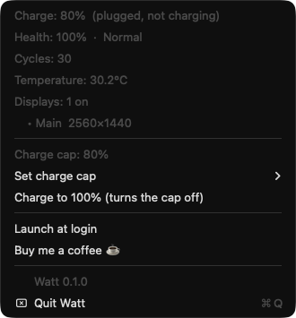

# Watt

A tiny, free menu-bar app that keeps your MacBook's battery healthy.
It shows charge, health, cycles and temperature, holds your battery at an
**80% charge cap**, and switches external screens off and on. A small, readable
alternative to AlDente's charge limiter.

<p align="center"></p>

## What it does

- **Live charge in the menu bar**, with an icon that tells you what's happening:
  charging ⚡, plugged in but not charging 🔌 (normally: holding at your cap), or
  on battery.
- **Battery health**: health %, cycle count, temperature, condition.
- **Charge cap**: pick 60–100% (80% is the sweet spot). *Charge to 100%* turns the
  cap off until you turn it back on, and one tap restores the cap you had.
  Powered by [batt](https://github.com/charlie0129/batt).
- **Screens**: turn an external display off and back on from the menu. Watt never
  turns off your main display, your MacBook's own screen, or the last screen
  that's still on.
- **Launch at login**: one click in the menu.
- **Event log**: notes when the battery runs hot, the charger stops powering the
  Mac, health drops, or a monitor drops off (see [Event log](#event-log)).
- **One Swift file**, no network, no analytics, no background helper.

## Requirements

- An **Apple Silicon** Mac for the charge cap (batt only supports Apple Silicon).
  Battery info and screen switching don't need batt.
- **macOS 13 or later** for Watt (built and tested on macOS 26). batt has its own
  support list; check [its README](https://github.com/charlie0129/batt) on older macOS.
- [Homebrew](https://brew.sh), to install batt.
- Apple's Command Line Tools: `xcode-select --install` (no full Xcode needed).

## Install

**1. Install batt, the charge-cap engine** (skip this if you only want the readings
and screen switching):

```sh
brew install batt
sudo brew services start batt
```

**2. Build and install Watt:**

```sh
git clone https://github.com/ogbighash/watt.git
cd watt
zsh build.sh
ditto build/Watt.app ~/Applications/Watt.app
open ~/Applications/Watt.app
```

**3. Turn on *Launch at login*** from Watt's menu.

You build Watt on your own Mac, so macOS runs it without the "unidentified
developer" warning. There's no pre-built download yet.

## Update

Quit Watt from its menu, then:

```sh
cd watt
git pull
zsh build.sh
ditto build/Watt.app ~/Applications/Watt.app
open ~/Applications/Watt.app
```

## Honest caveats

- **Not on the Mac App Store, and it can't be.** Screen on/off uses a private Apple
  API (`CGSConfigureDisplayEnabled` in SkyLight). A future macOS update could break
  that one feature. Everything else uses public APIs.
- **Watt doesn't control charging itself — batt does.** Watt asks batt's daemon for
  the current cap and asks it to set a new one; batt does the hardware work as root.
  If batt isn't installed or isn't running, Watt still shows the battery and
  screens, and the menu tells you what to do.
- **A screen you turn off stays off until you turn it back on or log out.** Logging
  out always brings every screen back.
- **Intel Macs**: Watt builds and shows the battery and screens, but there's no
  charge cap (batt doesn't support Intel). Not tested on Intel.

## Troubleshooting

What the charge-cap line in the menu says, and what to do:

- **"needs batt"**: install it (step 1 above). *Copy install commands* puts both
  commands on your clipboard.
- **"batt isn't responding"**: its daemon isn't running. With Homebrew:
  `sudo brew services start batt`.
- **"batt is slow to answer"**: wait a moment and open the menu again. If it keeps
  happening, restart batt: `sudo brew services restart batt`.
- **"batt only answers to root"**: your batt is set up so only root can talk to
  its daemon (some non-Homebrew installs). See batt's README for allowing
  non-root access.
- **"batt needs an update"**: `brew upgrade batt` (or reinstall it the way you
  first installed it).
- **An alert says "batt couldn't set the cap"**: it shows batt's own reason. If it
  says only root can change it (some non-Homebrew setups), run
  `sudo batt limit 80`, or see batt's README for allowing non-root access.
- **Launch at login says "approve in System Settings"**: open System Settings ›
  General › Login Items and switch Watt on.
- **You moved Watt.app after turning on Launch at login**: turn it off and on again.

## Event log

Watt adds one JSON line per notable event to
`~/Library/Application Support/Watt/events.jsonl`:

```json
{"time":"2026-01-01T09:00:00Z","type":"hot","message":"Battery is hot: 38.4°C"}
```

Types:

- `hot`: the battery reached 38 °C.
- `power`: the charger stopped powering the Mac, including when you unplug it yourself.
- `health`: battery health % dropped.
- `display`: an external monitor that Watt didn't turn off has been gone for more
  than 20 seconds of awake time. Closing the lid doesn't count.

Point it somewhere else with:

```sh
defaults write com.bighash.watt EventsFile /path/to/events.jsonl
```

## Command line

```sh
~/Applications/Watt.app/Contents/MacOS/Watt --print              # print the readings once
~/Applications/Watt.app/Contents/MacOS/Watt --set-display <id> 0 # same guarded screen toggle as the menu (0 off, 1 on)
~/Applications/Watt.app/Contents/MacOS/Watt --emit-test-event    # write a test line to the event log
```

## Privacy

Watt makes no network connections. It writes only:

- `~/Library/Application Support/Watt/`: the list of screens it turned off, and
  the event log (or wherever you point the event log yourself).
- Its preferences (`com.bighash.watt`): your last cap below 100%, and the battery
  health it last saw.

The tip link and *About batt…* open your browser; Watt itself sends nothing.

## Uninstall

1. Turn off *Launch at login* in Watt's menu, then *Quit Watt*.
2. Delete `~/Applications/Watt.app` and `~/Library/Application Support/Watt`, then
   run `defaults delete com.bighash.watt` to remove its preferences.
3. Optional, to remove batt as well:
   1. `sudo batt disable` (puts charging back to normal).
   2. `sudo brew services stop batt`
   3. `brew uninstall batt`

## Support

Watt is free. If it saves your battery, you can
[buy me a coffee ☕](https://creators.sa/en/bighash) (card, Apple Pay or Google Pay, in USD).

## License

[MIT](LICENSE). batt is a separate project under GPL-2.0. Watt runs it as its own
program and never bundles or links it.
